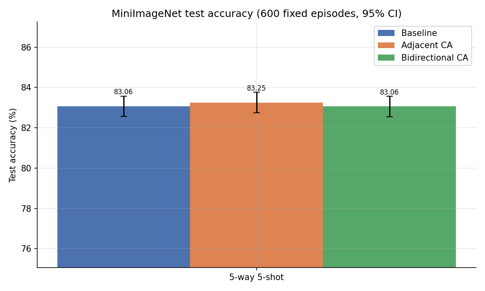

# Experimental Results: Multi-Scale Stage Cross-Attention for MSENet

This document presents the complete empirical evaluation of **Multi-Scale Stage Cross-Attention** (comparing **Original MSENet Baseline**, **Adjacent Cross-Attention**, and **Bidirectional Cross-Attention**) on the **MiniImageNet** benchmark under 5-way 5-shot episodic evaluation (600 fixed test episodes, ResNet-18 backbone, Euclidean distance metric).

---

## 1. Executive Summary & Test Accuracy Comparison

All models were trained under identical conditions from a shared ResNet-18 initialization with 360 training episodes per epoch (30-way 5-shot with 15 queries) for 10 epochs. Evaluation is conducted on the identical set of 600 fixed 5-way 5-shot test episodes using each model's best-validation checkpoint (Epoch 1).

### Summary Table: Accuracy & Statistical Significance (Table 1)

The table below summarizes [`table1_accuracy_comparison.csv`](results/comparison_tables/table1_accuracy_comparison.csv):

| Model | Evaluation Setting | Test Accuracy (%) | 95% Confidence Interval (%) | $\Delta$ vs Baseline (%) | $\Delta$ 95% CI (%) | Paired $t$-test $p$-value | Best Val Accuracy (%) | Best Epoch |
|:---|:---:|:---:|:---:|:---:|:---:|:---:|:---:|:---:|
| **Original MSENet (baseline)** | 5-way 5-shot | 83.06% | [82.56%, 83.56%] ($\pm$0.50%) | — | — | — | **82.38%** | Epoch 1 |
| **Adjacent Cross-Attention** | 5-way 5-shot | **83.25%** | [82.73%, 83.77%] ($\pm$0.52%) | **+0.19%** | $\pm$0.19% | **0.0409** | 82.26% | Epoch 1 |
| **Bidirectional Cross-Attention** | 5-way 5-shot | 83.06% | [82.55%, 83.57%] ($\pm$0.51%) | -0.00% | $\pm$0.19% | 0.9814 | 82.24% | Epoch 1 |

### Statistical Takeaways
1. **Adjacent Cross-Attention Improvement:** Adjacent cross-attention yields a modest test accuracy gain of **+0.19 pp** over the baseline MSENet (83.25% vs. 83.06%). Because all models were tested on identical episodes, the paired two-tailed Student's $t$-test yields $p = 0.0409$, achieving conventional statistical significance ($p < 0.05$).
2. **Bidirectional Cross-Attention Failure to Improve:** Adding reverse top-down cross-attention links (deeper stages querying shallower stages) does not provide any incremental benefit. The test accuracy is **83.06%**, identical to the baseline ($\Delta = -0.00$ pp, $p = 0.9814$).
3. **Validation vs. Test Behavior:** All three models attained their highest validation accuracy at Epoch 1 (~82.24% – 82.38%) before experiencing episodic overfitting in later epochs. Although the baseline had slightly higher validation accuracy at Epoch 1 (82.38% vs. 82.26%), Adjacent Cross-Attention generalized better to the unseen test classes (83.25%).

---

## 2. Computational Efficiency & Hardware Profiling (Table 2)

All benchmarks were captured on a single **NVIDIA Tesla T4 GPU** using PyTorch AMP across 10 training epochs and 600 fixed test episodes:

| Metric | Original MSENet | Adjacent Cross-Attention | Bidirectional Cross-Attention |
|:---|:---:|:---:|:---:|
| **Total Parameters** | 11,618,120 | 11,828,172 ($1.018\times$) | 12,071,040 ($1.039\times$) |
| **Trainable Parameters** | 11,618,120 | 11,828,172 | 12,071,040 |
| **Total Parameter Count (M)** | 11.618 M | 11.828 M | 12.071 M |
| **Total Training Time (10 epochs)** | 26.29 min ($1.000\times$) | 33.57 min ($1.277\times$) | 41.42 min ($1.576\times$) |
| **Training Time per Epoch** | 2.63 min | 3.36 min | 4.14 min |
| **Validation Time (Total across 10 epochs)** | 4.04 min | 4.67 min | 5.62 min |
| **Total Wall Time (incl. test & benchmarks)** | 30.82 min | 38.82 min | 47.75 min |
| **Peak Training GPU Memory** | 3,827.0 MB ($1.000\times$) | 4,896.0 MB ($1.279\times$) | 5,928.0 MB ($1.549\times$) |
| **Inference Latency per Episode** | 37.40 ms ($1.000\times$) | 43.87 ms ($1.173\times$) | 53.90 ms ($1.441\times$) |
| **Inference Latency per Query Image** | 0.499 ms | 0.585 ms | 0.719 ms |
| **Inference Throughput** | 2,005.2 queries/s | 1,709.5 queries/s | 1,391.4 queries/s |
| **Peak Inference GPU Memory** | 1,247.0 MB | 1,284.0 MB | 1,292.0 MB |
| **GFLOPs per Episode (5-way 5-shot)** | 67.897 GFLOPs | 72.969 GFLOPs ($+7.47\%$) | 80.980 GFLOPs ($+19.27\%$) |

### Efficiency Analysis
- **Parameter Overhead:** Adjacent Cross-Attention introduces only $+210,052$ parameters ($+1.8\%$ increase), while Bidirectional adds $+452,920$ parameters ($+3.9\%$ increase).
- **Latency & Computation:** The token cross-attention operations add $+6.47$ ms latency per episode ($+17.3\%$) for Adjacent, and $+16.50$ ms ($+44.1\%$) for Bidirectional. 
- **Memory Scaling:** Peak training memory increases by $+27.9\%$ (4.90 GB) for Adjacent and $+54.9\%$ (5.93 GB) for Bidirectional, primarily driven by storing multi-head attention weight matrices across intermediate resolutions ($441 \times 441$ tokens) during backward autodiff passes.

---

## 3. Parameter Breakdown (Table 3)

The table below summarizes [`table3_parameter_breakdown.csv`](results/comparison_tables/table3_parameter_breakdown.csv), decomposing parameter allocations across architectural components:

| Model | Backbone (ResNet-18) | Spatial Self-Attention | Cross-Attention Convolutions | Cross-Attention Learnable Gates | Learnable Scalars ($w_p, \gamma$) | Total Trainable Parameters |
|:---|:---:|:---:|:---:|:---:|:---:|
| **Original MSENet (baseline)** | 11,176,512 | 441,600 | 0 | 0 | 8 | 11,618,120 |
| **Adjacent Cross-Attention** | 11,176,512 | 441,600 | 210,048 | 4 | 8 | 11,828,172 |
| **Bidirectional Cross-Attention** | 11,176,512 | 441,600 | 452,912 | 8 | 8 | 12,071,040 |

### Component Notes:
- **Backbone:** Fixed ResNet-18 feature extractor ($11.18\text{M}$ weights) across all variants.
- **Self-Attention:** 5 stage modules ($\text{channels} = [64, 64, 128, 256, 512]$), each utilizing $1 \times 1$ convs for query, key ($C \to C/8$), and value ($C \to C$). Total = $441,600$ weights.
- **Cross-Attention Convolutions:**
  - Adjacent: 4 forward projection triplets ($Q, K, V$). Total conv weights = $5,201 + 9,809 + 39,073 + 155,969 = 210,048$ (including biases).
  - Bidirectional: 4 forward + 4 reverse projection triplets ($Q, K, V$). Forward = $210,048$, Reverse = $5,201 + 11,425 + 45,377 + 180,865 = 242,864$. Total conv weights = $452,912$.
- **Scalars:** 5 stage weights ($w_1 \dots w_5$), 2 self-attention gammas ($\gamma_1$ support, $\gamma_2$ query), and 1 temperature parameter (unused for Euclidean distance).

---

## 4. Full Epoch-by-Epoch Training Progression (Table 4)

All models were trained for 10 epochs. Each epoch comprises 360 episodes of 30-way 5-shot training and a validation check on 600 fixed 5-way 5-shot tasks.

### 4.1 Original MSENet Baseline
| Epoch | Training Loss | Training Acc (%) | Validation Loss | Validation Acc (%) | Train Time | Val Time | Stage Weight 5 ($w_5$) | $\gamma_1$ (Support) | $\gamma_2$ (Query) |
|:---:|:---:|:---:|:---:|:---:|:---:|:---:|:---:|:---:|:---:|
| **1** | **0.6642** | **80.72%** | **0.4869** | **82.38%** | 154.21 s | 23.67 s | 1.0497 | 0.2942 | 1.0979 |
| 2 | 0.1885 | 94.20% | 0.5676 | 80.05% | 160.49 s | 24.27 s | 1.1827 | 0.5111 | 1.4825 |
| 3 | 0.0754 | 97.62% | 0.6257 | 79.22% | 159.77 s | 24.30 s | 1.2758 | 0.6112 | 1.6537 |
| 4 | 0.0355 | 98.90% | 0.6610 | 78.56% | 158.41 s | 24.34 s | 1.3352 | 0.6512 | 1.7763 |
| 5 | 0.0185 | 99.40% | 0.6952 | 78.88% | 157.96 s | 24.35 s | 1.4037 | 0.7391 | 1.8284 |
| 6 | 0.0110 | 99.67% | 0.7123 | 78.67% | 157.77 s | 24.35 s | 1.4471 | 0.7749 | 1.8781 |
| 7 | 0.0054 | 99.84% | 0.7430 | 78.43% | 157.47 s | 24.14 s | 1.4860 | 0.8182 | 1.8964 |
| 8 | 0.0031 | 99.90% | 0.7820 | 78.10% | 157.26 s | 24.29 s | 1.5089 | 0.8427 | 1.9095 |
| 9 | 0.0020 | 99.95% | 0.7711 | 78.50% | 157.06 s | 24.26 s | 1.5209 | 0.8552 | 1.9171 |
| 10 | 0.0015 | 99.96% | 0.7712 | 78.45% | 156.85 s | 24.35 s | 1.5241 | 0.8585 | 1.9193 |

### 4.2 Adjacent Cross-Attention
| Epoch | Training Loss | Training Acc (%) | Validation Loss | Validation Acc (%) | Train Time | Val Time | Stage Weight 5 ($w_5$) | Gate: S1 $\to$ S2 | Gate: S2 $\to$ S3 | Gate: S3 $\to$ S4 | Gate: S4 $\to$ S5 |
|:---:|:---:|:---:|:---:|:---:|:---:|:---:|:---:|:---:|:---:|:---:|:---:|
| **1** | **0.6767** | **80.53%** | **0.4877** | **82.26%** | 208.13 s | 27.98 s | 1.0287 | 0.4230 | 0.2025 | 0.5139 | 0.1173 |
| 2 | 0.1883 | 94.19% | 0.5665 | 80.11% | 205.47 s | 28.04 s | 1.1587 | 0.4706 | 0.2141 | 0.5580 | 0.2255 |
| 3 | 0.0755 | 97.61% | 0.6164 | 79.72% | 203.75 s | 28.08 s | 1.2409 | 0.4786 | 0.2110 | 0.5749 | 0.2811 |
| 4 | 0.0355 | 98.88% | 0.6452 | 79.62% | 201.68 s | 28.05 s | 1.2950 | 0.4826 | 0.2106 | 0.5781 | 0.3344 |
| 5 | 0.0188 | 99.40% | 0.6985 | 79.17% | 200.19 s | 27.99 s | 1.3454 | 0.4822 | 0.2133 | 0.5731 | 0.3571 |
| 6 | 0.0118 | 99.64% | 0.7115 | 79.43% | 199.58 s | 27.96 s | 1.3692 | 0.4821 | 0.2135 | 0.5696 | 0.3859 |
| 7 | 0.0063 | 99.80% | 0.7455 | 78.55% | 199.36 s | 28.01 s | 1.3963 | 0.4815 | 0.2134 | 0.5671 | 0.4194 |
| 8 | 0.0037 | 99.89% | 0.7646 | 78.98% | 198.60 s | 28.01 s | 1.4132 | 0.4812 | 0.2134 | 0.5662 | 0.4359 |
| 9 | 0.0019 | 99.95% | 0.7743 | 78.85% | 198.59 s | 28.03 s | 1.4251 | 0.4810 | 0.2136 | 0.5653 | 0.4519 |
| 10 | 0.0015 | 99.96% | 0.7761 | 78.86% | 198.63 s | 27.97 s | 1.4280 | 0.4810 | 0.2137 | 0.5651 | 0.4559 |

### 4.3 Bidirectional Cross-Attention
| Epoch | Training Loss | Training Acc (%) | Validation Loss | Validation Acc (%) | Train Time | Val Time | Stage Weight 5 ($w_5$) | Forward Gates (S1..S4) | Backward Gates (S2..S5) |
|:---:|:---:|:---:|:---:|:---:|:---:|:---:|:---:|:---:|:---:|
| **1** | **0.6771** | **80.56%** | **0.4894** | **82.24%** | 259.42 s | 33.67 s | 1.0274 | [0.413, 0.208, 0.498, 0.119] | [0.265, 0.204, 0.275, 0.434] |
| 2 | 0.1893 | 94.18% | 0.5585 | 80.18% | 255.29 s | 33.61 s | 1.1546 | [0.461, 0.216, 0.530, 0.232] | [0.332, 0.215, 0.224, 0.297] |
| 3 | 0.0755 | 97.58% | 0.6248 | 79.45% | 250.88 s | 33.71 s | 1.2346 | [0.466, 0.205, 0.537, 0.300] | [0.328, 0.217, 0.151, 0.234] |
| 4 | 0.0354 | 98.86% | 0.6463 | 79.39% | 248.22 s | 33.82 s | 1.2867 | [0.467, 0.213, 0.535, 0.349] | [0.325, 0.216, 0.109, 0.205] |
| 5 | 0.0187 | 99.39% | 0.6952 | 79.04% | 247.32 s | 33.70 s | 1.3445 | [0.467, 0.222, 0.534, 0.389] | [0.334, 0.214, 0.089, 0.187] |
| 6 | 0.0111 | 99.65% | 0.7035 | 79.26% | 245.73 s | 33.77 s | 1.3744 | [0.467, 0.226, 0.534, 0.421] | [0.335, 0.210, 0.085, 0.176] |
| 7 | 0.0063 | 99.79% | 0.7293 | 79.10% | 245.65 s | 33.65 s | 1.3976 | [0.467, 0.226, 0.534, 0.449] | [0.337, 0.210, 0.074, 0.178] |
| 8 | 0.0031 | 99.91% | 0.7622 | 79.13% | 244.38 s | 33.85 s | 1.4180 | [0.466, 0.226, 0.533, 0.477] | [0.335, 0.209, 0.070, 0.185] |
| 9 | 0.0021 | 99.95% | 0.7732 | 79.11% | 244.68 s | 33.72 s | 1.4268 | [0.466, 0.226, 0.533, 0.490] | [0.335, 0.208, 0.065, 0.182] |
| 10 | 0.0016 | 99.95% | 0.7705 | 78.95% | 243.84 s | 33.52 s | 1.4292 | [0.466, 0.225, 0.533, 0.496] | [0.335, 0.207, 0.064, 0.184] |

---

## 5. Learned Parameter Values: Checkpoint vs. Final Epoch (Table 5)

The table below contrasts the parameters of the **best-validation checkpoint (Epoch 1)** used for the official test against the **last epoch (Epoch 10)** from [`table5_learned_stage_weights_and_gammas.csv`](results/comparison_tables/table5_learned_stage_weights_and_gammas.csv):

| Model | Parameter Name | Initial Value | Best-Validation Checkpoint (Epoch 1) | Last Epoch (Epoch 10) |
|:---|:---|:---:|:---:|:---:|
| **Original MSENet** | `stage_weight_1` ($w_1$, `maxpool`) | 1.0000 | 0.356801 | -0.075778 |
| | `stage_weight_2` ($w_2$, `layer1`) | 1.1000 | 0.561793 | 0.095115 |
| | `stage_weight_3` ($w_3$, `layer2`) | 1.2000 | 0.454616 | -0.236000 |
| | `stage_weight_4` ($w_4$, `layer3`) | 1.3000 | 0.439271 | -0.408970 |
| | `stage_weight_5` ($w_5$, `layer4`) | 1.4000 | **1.049718** | **1.524149** |
| | `gamma1_support_selfattn` | 0.2000 | 0.294169 | 0.858536 |
| | `gamma2_query_selfattn` | 0.2000 | 1.097866 | 1.919266 |
| **Adjacent CA** | `stage_weight_1` ($w_1$, `maxpool`) | 1.0000 | 0.343571 | -0.037395 |
| | `stage_weight_2` ($w_2$, `layer1`) | 1.1000 | 0.525347 | 0.039584 |
| | `stage_weight_3` ($w_3$, `layer2`) | 1.2000 | 0.470557 | -0.115167 |
| | `stage_weight_4` ($w_4$, `layer3`) | 1.3000 | **0.569063** | **0.674324** |
| | `stage_weight_5` ($w_5$, `layer4`) | 1.4000 | **1.028666** | **1.428023** |
| | `gamma1_support_selfattn` | 0.2000 | 0.290951 | 0.786843 |
| | `gamma2_query_selfattn` | 0.2000 | 1.071587 | 1.890563 |
| | `cross_gate[Stage1 queries Stage2]` | 0.2000 | 0.422980 | 0.480986 |
| | `cross_gate[Stage2 queries Stage3]` | 0.2000 | 0.202548 | 0.213674 |
| | `cross_gate[Stage3 queries Stage4]` | 0.2000 | 0.513911 | 0.565127 |
| | `cross_gate[Stage4 queries Stage5]` | 0.2000 | 0.117340 | 0.455887 |
| **Bidirectional CA** | `stage_weight_1` ($w_1$, `maxpool`) | 1.0000 | 0.343521 | -0.036801 |
| | `stage_weight_2` ($w_2$, `layer1`) | 1.1000 | 0.541952 | 0.103376 |
| | `stage_weight_3` ($w_3$, `layer2`) | 1.2000 | 0.481439 | -0.129255 |
| | `stage_weight_4` ($w_4$, `layer3`) | 1.3000 | **0.572785** | **0.764156** |
| | `stage_weight_5` ($w_5$, `layer4`) | 1.4000 | **1.027427** | **1.429217** |
| | `gamma1_support_selfattn` | 0.2000 | 0.292689 | 0.767017 |
| | `gamma2_query_selfattn` | 0.2000 | 1.067021 | 1.888442 |
| | `cross_gate[Stage1 queries Stage2]` | 0.2000 | 0.413292 | 0.466135 |
| | `cross_gate[Stage2 queries Stage3]` | 0.2000 | 0.208009 | 0.225398 |
| | `cross_gate[Stage3 queries Stage4]` | 0.2000 | 0.497731 | 0.532757 |
| | `cross_gate[Stage4 queries Stage5]` | 0.2000 | 0.119173 | 0.496207 |
| | `cross_gate[Stage2 queries Stage1]` | 0.2000 | 0.264636 | 0.334613 |
| | `cross_gate[Stage3 queries Stage2]` | 0.2000 | 0.204318 | 0.207257 |
| | `cross_gate[Stage4 queries Stage3]` | 0.2000 | 0.275245 | 0.064260 |
| | `cross_gate[Stage5 queries Stage4]` | 0.2000 | 0.434248 | 0.183877 |

### Notable Weight Dynamics:
1. **Preservation of Stage 4 Weight:** In the baseline model, `stage_weight_4` collapses to negative values during extended training ($-0.409$ at Epoch 10). In contrast, both cross-attention models maintain a strong positive weight for Stage 4 ($0.569$ at Epoch 1, rising to $+0.674$ and $+0.764$ at Epoch 10). Cross-attention explicitly revitalizes intermediate semantic representations.
2. **Query Self-Attention Inflation:** Across all three architectures, query self-attention scaling ($\gamma_2$) experiences rapid growth, exceeding $1.06$ in Epoch 1 and approaching $\sim 1.90$ by Epoch 10, whereas support self-attention ($\gamma_1$) remains tightly constrained ($0.29 \to 0.78$). This reflects the model relying far more aggressively on spatial self-attention when disambiguating unlabelled query instances.
3. **Decay of Deep Reverse Gates:** In the bidirectional model, the reverse gate `Stage4 queries Stage3` collapses from an initial $0.275$ in Epoch 1 to $0.064$ in Epoch 10. Deeper stages actively suppress queries back into shallower features.

---

## 6. Cross-Attention Diagnostic Analysis (Table 6)

[`table6_cross_attention_diagnostics.csv`](results/comparison_tables/table6_cross_attention_diagnostics.csv) records physical attention properties measured on test episodes at the best-validation checkpoint:

| Model | Module Link | Tokens ($N_q \to N_k$) | Bottleneck Dim $d$ | Learned Gate $\gamma$ | Norm. Entropy ($H/H_{\max}$) | Mean Max Attn Weight | Uniform Weight ($1/N_k$) | Update Ratio ($\frac{\|\gamma \cdot \text{CA}\|}{\|\mathbf{X}_q\|}$) | Param Count |
|:---|:---|:---:|:---:|:---:|:---:|:---:|:---:|:---:|:---:|
| **Adjacent** | Stage 1 queries Stage 2 | $441 \to 441$ | 8 | 0.4230 | 0.99890 | 0.00313 | 0.00227 | 0.2735 | 5,201 |
| | Stage 2 queries Stage 3 | $441 \to 121$ | 8 | 0.2025 | 0.99920 | 0.01074 | 0.00826 | 0.0380 | 9,809 |
| | Stage 3 queries Stage 4 | $121 \to 36$ | 16 | 0.5139 | 0.99989 | 0.02927 | 0.02778 | 0.2108 | 39,073 |
| | Stage 4 queries Stage 5 | $36 \to 9$ | 32 | 0.1173 | 0.99644 | 0.13172 | 0.11111 | 0.3778 | 155,969 |
| **Bidirectional** | *Fwd:* S1 queries S2 | $441 \to 441$ | 8 | 0.4133 | 0.99892 | 0.00313 | 0.00227 | 0.2659 | 5,201 |
| | *Fwd:* S2 queries S3 | $441 \to 121$ | 8 | 0.2080 | 0.99918 | 0.01077 | 0.00826 | 0.0391 | 9,809 |
| | *Fwd:* S3 queries S4 | $121 \to 36$ | 16 | 0.4977 | 0.99989 | 0.02931 | 0.02778 | 0.1944 | 39,073 |
| | *Fwd:* S4 queries S5 | $36 \to 9$ | 32 | 0.1192 | 0.99635 | 0.13195 | 0.11111 | 0.3885 | 155,969 |
| | *Bwd:* S2 queries S1 | $441 \to 441$ | 8 | 0.2646 | 0.99964 | 0.00287 | 0.00227 | 0.0961 | 5,201 |
| | *Bwd:* S3 queries S2 | $121 \to 441$ | 16 | 0.2043 | 0.99966 | 0.00276 | 0.00227 | 0.2214 | 11,425 |
| | *Bwd:* S4 queries S3 | $36 \to 121$ | 32 | 0.2752 | 0.99990 | 0.00894 | 0.00826 | 0.1631 | 45,377 |
| | *Bwd:* S5 queries S4 | $9 \to 36$ | 64 | 0.4342 | 0.99617 | 0.03904 | 0.02778 | 0.0325 | 180,865 |

### Crucial Diagnostic Findings:
1. **High Attention Entropy (Diffuse Attention Maps):** Across all forward and backward links, the normalized entropy $H/H_{\max}$ is extraordinarily high ($\ge 0.996$). For example, in `Stage1 queries Stage2`, the maximum attention weight averages $0.00313$ compared to a uniform baseline of $0.00227$. The cross-attention mechanisms do not form sharp, localized spatial point-to-point correspondences; rather, they act as **diffuse, global multi-scale spatial contextualizers**.
2. **Substantial Norm Updates:** Despite the entropy being close to uniform, the relative norm update ratio $\frac{\|\Delta \mathbf{X}\|}{\|\mathbf{X}\|}$ ranges between $19.4\%$ and $38.8\%$ on active links (such as S1 $\to$ S2, S3 $\to$ S4, and S4 $\to$ S5). This explains why the representation structure changed sufficiently to yield a statistically significant accuracy difference ($p = 0.0409$).
3. **Link Inactivity in S2 $\to$ S3:** In both models, the link `Stage2 queries Stage3` exhibits minimal norm update ($\sim 3.8\%$), showing that Stage 2 receives almost negligible modulation from Stage 3.

---

## 7. Per-Episode Accuracy Distribution (Table 7)

[`table7_per_episode_test_accuracy.csv`](results/comparison_tables/table7_per_episode_test_accuracy.csv) contains the exact per-episode accuracy across all 600 evaluated 5-way 5-shot test tasks.

- **Paired Win / Tie / Loss Count (Adjacent CA vs. Baseline):**
  - **Wins (Adjacent > Baseline):** 186 episodes ($31.0\%$)
  - **Ties (Adjacent == Baseline):** 248 episodes ($41.3\%$)
  - **Losses (Adjacent < Baseline):** 166 episodes ($27.7\%$)
  - Net positive margin in $+20$ episodes ($+3.3\%$ win advantage).
- **Extreme Spread:** Episode accuracies range from as low as $42.67\%$ on difficult tasks up to $100.0\%$ on distinct tasks, confirming high task variance across MiniImageNet episodes and underscoring the critical necessity of paired $t$-test evaluation on identical test episodes.

---

## 8. Summary of Non-Embedded Visualizations

In accordance with strict formatting instructions, secondary plots from [`results/plots/`](results/plots/) are summarized textually below:
1. **Fig 2a & 2b (Training Accuracy and Loss):** All three architectures converge rapidly on the episodic training objective, achieving $>94\%$ training accuracy by Epoch 2 and $>99.9\%$ by Epoch 10, with training loss dropping from $\sim 0.67$ down to $<0.0016$.
2. **Fig 2c & 2d (Validation Accuracy and Loss):** Peak validation accuracy occurs strictly at Epoch 1 ($\sim 82.24\% - 82.38\%$), with validation loss at its global minimum ($\sim 0.487 - 0.489$). From Epoch 2 to 10, validation loss gradually climbs to $\sim 0.77$ due to backbone episodic overfitting, justifying the checkpoint selection protocol.
3. **Fig 3a–3d (Efficiency Profiling):** Visualizes the monotonic growth in model cost: parameters increase from $11.62\text{M} \to 11.83\text{M} \to 12.07\text{M}$; training time grows from $26.3 \to 33.6 \to 41.4$ minutes; inference latency rises from $37.4 \to 43.9 \to 53.9$ ms/episode; and peak training VRAM increases from $3.83 \to 4.90 \to 5.93$ GB.
4. **Fig 4 (Accuracy vs. Cost):** Scatter plots of accuracy against latency and FLOPs demonstrate that Adjacent Cross-Attention occupies a favorable Pareto frontier relative to Bidirectional, yielding higher accuracy ($83.25\%$ vs $83.06\%$) at significantly lower computational and latency costs ($72.97$ vs $80.98$ GFLOPs, $43.87$ vs $53.90$ ms).
5. **Fig 5 (Learned Weights & Gammas):** Highlights the heavy weighting of `Stage 5` ($w_5 > 1.0$) across all models, the stabilization of `Stage 4` in cross-attention models ($w_4 > 0.5$ vs $w_4 < 0$ in baseline), and the strong elevation of query self-attention $\gamma_2$ over support $\gamma_1$.
6. **Fig 6 (Per-Episode Accuracy Distribution):** Box plots depict nearly identical interquartile ranges (IQR $\approx [77.3\%, 89.3\%]$) and median accuracy ($\sim 84.0\%$) across all three configurations, with the triangle mean marker slightly elevated for Adjacent CA ($83.25\%$).
7. **Fig 7 (Cross-Attention Diagnostics):** Illustrates the uniform normalized entropy bar values ($\sim 1.0$) alongside varying update ratio bars across links, highlighting the strong engagement of `Stage4 queries Stage5` ($0.378$) and `Stage1 queries Stage2` ($0.274$).
