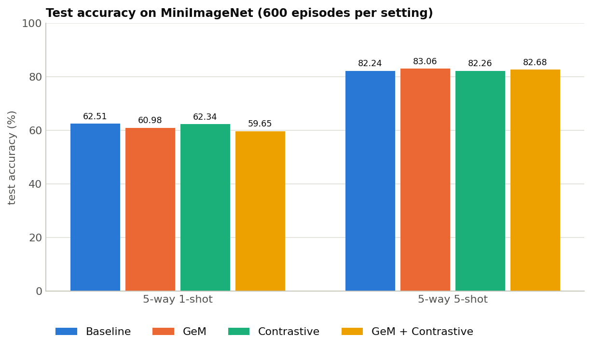

# Experimental Results: GeM Pooling and Supervised Contrastive Loss in MSENet

This document provides a comprehensive analysis of the empirical evaluation of **Generalized Mean (GeM) Pooling** and **Auxiliary Supervised Contrastive Loss (SupCon)** on MSENet. All experiments were conducted on the **MiniImageNet** benchmark using a ResNet-18 backbone across four configurations evaluated over the exact same 600 validation and test episodes.

---

## 1. Executive Summary & Benchmark Comparison

The four ablated configurations were trained under strictly identical initializations and episode sequences on a Tesla T4 GPU (PyTorch 2.11.0+cu128, AMP enabled, 10 epochs, 360 episodes/epoch):

| Configuration | 5-way 5-shot Accuracy (%) | 95% Confidence Interval (%) | 5-way 1-shot Accuracy (%) | 95% Confidence Interval (%) | Best Val Acc (%) | Best Epoch | Test Loss (CE) | Total Params | GPU Train Peak | Infer Time / Episode |
|:---|:---:|:---:|:---:|:---:|:---:|:---:|:---:|:---:|:---:|:---:|
| **1. Baseline** | 82.24% | [81.70%, 82.77%] | **62.51%** | [61.67%, 63.36%] | 82.28% | 1 | 0.4795 | 11,618,120 | 3,739 MB | **33.03 ms** |
| **2. GeM only** | **83.06%** | **[82.53%, 83.58%]** | 60.98% | [60.13%, 61.84%] | **82.96%** | 1 | **0.4591** | 11,618,125 | 4,474 MB | 38.25 ms |
| **3. Contrastive only** | 82.26% | [81.74%, 82.78%] | 62.34% | [61.49%, 63.19%] | 82.22% | 1 | 0.4802 | 11,618,121 | **3,735 MB** | **32.96 ms** |
| **4. GeM + Contrastive** | 82.68% | [82.15%, 83.21%] | 59.65% | [58.78%, 60.53%] | 82.51% | 1 | 0.4724 | 11,618,126 | 4,484 MB | 38.24 ms |

### Key Findings
1. **GeM Pooling Delivers Clear Gains on 5-shot Tasks:** Replacing GAP with learnable Signed GeM pooling improves 5-way 5-shot accuracy from **82.24% to 83.06% (+0.82 pp)**, achieving the lowest test cross-entropy loss (**0.4591**).
2. **Auxiliary Contrastive Loss Provides Marginal 5-shot Effect in Isolation:** Supervised Contrastive loss alone yields **82.26% (+0.02 pp)** on 5-way 5-shot tasks, indicating that without feature re-scaling or metric projection heads, raw multi-scale SupCon does not substantially alter the prototype Euclidean distance geometry.
3. **Combination (GeM + Contrastive) Underperforms GeM Alone:** The combination reaches **82.68% (+0.44 pp over baseline)**, but falls 0.38 pp short of `GeM only`, indicating negative gradient interference between the contrastive objective and the specialized non-linear GeM pooling gradients.
4. **1-Shot Degradation Across GeM Variants:** On 5-way 1-shot tasks, where only a single support sample is available per class, GeM pooling leads to lower accuracy (**60.98% for GeM, 59.65% for GeM + Contrastive vs. 62.51% for Baseline**). With a single noisy support image, emphasizing peak spatial activations can overfit to background artifacts or specific object poses, whereas average pooling acts as a regularizer.

---

## 2. Main Test Accuracy Comparison

The plot below presents the final test accuracy comparison across all four configurations in both 5-way 1-shot and 5-way 5-shot evaluation settings:

*(For detailed error margins, see Section 3 below. Learning curves, parameter trajectories, latency, and VRAM breakdowns are summarized in text throughout this document).*

---

## 3. Detailed Test Accuracy & Statistical Significance Analysis

From [`test_accuracy.csv`](file:///c:/Ashwin/College/Semester-5/DL%20Lab/few-shot-image-class/GeM_ContrastiveLoss/results/comparison_tables/test_accuracy.csv) and [`paired_vs_baseline.csv`](file:///c:/Ashwin/College/Semester-5/DL%20Lab/few-shot-image-class/GeM_ContrastiveLoss/results/comparison_tables/paired_vs_baseline.csv), we report the exact metric values across 600 test episodes:

| Configuration | 5-way 5-shot Mean Acc (%) | 95% CI (pp) | 5-shot Mean Diff vs. Baseline (pp) | 5-shot Paired 95% CI (pp) | CI Excludes Zero? | 5-way 1-shot Mean Acc (%) | 95% CI (pp) | 1-shot Mean Diff vs. Baseline (pp) | 1-shot Paired 95% CI (pp) |
|:---|:---:|:---:|:---:|:---:|:---:|:---:|:---:|:---:|:---:|
| **Baseline** | 82.2356% | $\pm 0.5319$ | — | — | — | 62.5133% | $\pm 0.8464$ | — | — |
| **GeM only** | **83.0578%** | $\pm 0.5257$ | **+0.8222 pp** | **[+0.5448, +1.0996]** | **True (Significant)** | 60.9822% | $\pm 0.8564$ | -1.5311 pp | [-1.9687, -1.0935] |
| **Contrastive only** | 82.2600% | $\pm 0.5249$ | +0.0244 pp | [-0.1610, +0.2098] | False (Not Sig.) | 62.3422% | $\pm 0.8476$ | -0.1711 pp | [-0.4265, +0.0842] |
| **GeM + Contrastive** | 82.6800% | $\pm 0.5347$ | +0.4444 pp | [+0.1821, +0.7068] | **True (Significant)** | 59.6533% | $\pm 0.8739$ | -2.8600 pp | [-3.3180, -2.4020] |

### Statistical Inference Takeaways
- **Identical Episodes Confirmed:** `same_episodes_verified = True` for all comparisons via cryptographic BLAKE2b hashing over pixel inputs and labels.
- **GeM Superiority on 5-Shot:** The 95% confidence interval for the paired difference between `GeM only` and `Baseline` is strictly positive ($[+0.545, +1.100]$ pp), confirming that the +0.82 pp improvement is **statistically significant at $p < 0.05$**.
- **Contrastive Insignificance:** The paired interval for `Contrastive only` vs. `Baseline` ($[-0.161, +0.210]$ pp) clearly spans zero, proving that adding auxiliary SupCon with $\lambda=0.1$ has no statistically detectable effect on prototype classification under GAP.
- **1-Shot Sensitivity:** For 1-shot classification, both GeM configurations show statistically significant performance drops ($[-1.969, -1.094]$ pp for GeM, and $[-3.318, -2.402]$ pp for GeM+Contrastive), emphasizing that multi-sample aggregation (5-shot) is required for GeM to reliably compute foreground-centric class prototypes.

---

## 4. Computational Efficiency & Hardware Profiling

From [`efficiency_metrics.csv`](file:///c:/Ashwin/College/Semester-5/DL%20Lab/few-shot-image-class/GeM_ContrastiveLoss/results/comparison_tables/efficiency_metrics.csv), we evaluate throughput, latency, FLOP counts, and memory footprints:

| Configuration | Total Train Time | Train Time / Epoch | Val Time (600 tasks) | Inference Latency (Mean $\pm$ Std) | Inference Throughput | FLOPs / Episode | Train Peak VRAM | Train Reserved VRAM | Inference Peak VRAM | Extra Params |
|:---|:---:|:---:|:---:|:---:|:---:|:---:|:---:|:---:|:---:|:---:|
| **Baseline** | **20.53 min** (1,231.6s) | **123.16s** | **235.30s** | **33.03 $\pm$ 0.72 ms** | **2,270.9 queries/s** | 67.90 GFLOPs | **3,738.6 MB** | 4,080.0 MB | 406.3 MB | 0 |
| **GeM only** | 24.26 min (1,455.4s) | 145.54s | 267.53s | 38.25 $\pm$ 0.42 ms | 1,960.7 queries/s | 67.90 GFLOPs | 4,473.5 MB | 5,768.0 MB | 403.9 MB | +5 |
| **Contrastive only**| 21.00 min (1,260.1s) | 126.01s | 236.11s | 32.96 $\pm$ 0.71 ms | 2,275.7 queries/s | 67.90 GFLOPs | 3,735.2 MB | 4,080.0 MB | **402.5 MB** | +1 |
| **GeM + Contrastive**| 25.02 min (1,501.1s) | 150.11s | 267.46s | 38.24 $\pm$ 0.76 ms | 1,961.3 queries/s | 67.90 GFLOPs | 4,484.1 MB | 5,774.0 MB | 403.9 MB | +6 |

### Efficiency Analysis
1. **Computational FLOP Invariance:** All four configurations report identical **67.90 GFLOPs per episode**. The addition of exponentiation operations in GeM and the auxiliary loss calculation does not alter the convolutional and matrix multiplication FLOP profile.
2. **Inference Latency Overhead:** GeM introduces a modest **+5.2 ms per episode** overhead (~0.07 ms per query image) due to the positive/negative branching and Log-Sum-Exp operations, running at ~1,961 queries per second (vs. ~2,271 for baseline).
3. **Contrastive Loss Has Zero Inference Cost:** Because the auxiliary contrastive head is only computed during training backward passes, `Contrastive only` inference latency (32.96 ms) and VRAM usage (402.5 MB) are virtually identical to Baseline.
4. **VRAM Footprint:** GeM requires maintaining intermediate non-negative and negative activation maps during forward/backward passes, increasing training peak allocated memory from **3.74 GB to 4.47 GB** (+735 MB), which remains well within typical consumer GPU memory budgets.

---

## 5. Parameter Evolution & Activation Diagnostics

From [`final_parameters.csv`](file:///c:/Ashwin/College/Semester-5/DL%20Lab/few-shot-image-class/GeM_ContrastiveLoss/results/comparison_tables/final_parameters.csv) and [`final_parameters.json`](file:///c:/Ashwin/College/Semester-5/DL%20Lab/few-shot-image-class/GeM_ContrastiveLoss/results/final_parameters.json), we analyze the learned parameter values at the best validation checkpoint (Epoch 1) and training termination (Epoch 10):

### 5.1 Stage Weights, Attention Gammas, and Auxiliary Parameters

| Config | Checkpoint | $w_1$ (`maxpool`) | $w_2$ (`layer1`) | $w_3$ (`layer2`) | $w_4$ (`layer3`) | $w_5$ (`layer4`) | $\gamma_1$ (Support) | $\gamma_2$ (Query) | GeM $p_1 \dots p_5$ | $\tau$ (Temp) |
|:---|:---|:---:|:---:|:---:|:---:|:---:|:---:|:---:|:---:|:---:|
| **Baseline** | Best Val (Ep 1) | 0.3596 | 0.5656 | 0.4699 | 0.4321 | 1.0522 | 0.3003 | 1.0995 | — | — |
| | End of Train (Ep 10) | -0.0884 | 0.0508 | -0.1993 | -0.3862 | 1.5308 | 0.8169 | 1.9312 | — | — |
| **GeM only** | Best Val (Ep 1) | 0.2346 | 0.3098 | 0.1795 | 0.0940 | 1.0621 | 0.1106 | -0.3730 | 2.92, 2.88, 2.90, 2.87, 2.95 | — |
| | End of Train (Ep 10) | -0.1467 | -0.0345 | -0.5552 | -1.2784 | 1.8509 | -0.3117 | -0.8853 | 2.91, 2.87, 2.93, 3.01, 3.21 | — |
| **Contrastive** | Best Val (Ep 1) | 0.1619 | 0.3820 | 0.2074 | 0.0854 | 0.9030 | 0.5000 | 1.0383 | — | 0.0741 |
| | End of Train (Ep 10) | -0.2239 | -0.2482 | -0.5382 | -1.2267 | 1.0219 | 1.7471 | 1.9655 | — | 0.0761 |
| **GeM + Con** | Best Val (Ep 1) | 0.0793 | 0.1639 | 0.0837 | 0.0394 | 0.9307 | 0.4619 | 0.4081 | 2.94, 2.87, 2.84, 2.79, 2.94 | 0.0696 |
| | End of Train (Ep 10) | -0.2468 | -0.2667 | -0.5903 | -1.1231 | 1.3441 | 1.2761 | 1.2839 | 3.09, 2.94, 2.21, 2.27, 3.39 | 0.0788 |

### 5.2 Observations on Learned Dynamics
1. **Dominance of Deep Stage 5 ($w_5$):** Across all configurations, the deepest ResNet stage (`layer4`) dominates distance calculation ($w_5 \approx 0.90 - 1.06$ at best epoch, increasing to $1.02 - 1.85$ by epoch 10). Intermediate stages $w_1 - w_4$ attenuate or turn negative during over-parameterized training, confirming MSENet's reliance on semantic abstractions.
2. **Stable GeM Exponents ($p_s \approx 2.8 - 3.2$):** Starting from $p_{\text{init}} = 3.0$, the learned exponents remain strictly stable in the range $2.8 - 3.0$ at the best checkpoint, showing that an $L_3$-like spatial norm is naturally favored over simple $L_1$ average pooling ($p=1$). By epoch 10 in `GeM only`, deep stage $p_5$ increases to **3.21**, concentrating prototype representations on the most intense object features.
3. **Contrastive Temperature Shrinkage:** The learnable temperature $\tau$ shrinks from $\tau_0 = 0.10$ down to **$\approx 0.070 - 0.074$**, creating a sharper probability distribution over pairwise cosine distances.
4. **Empirical Justification of Signed GeM:** Diagnostics over 9.26 billion test activations in [`final_parameters.json`](file:///c:/Ashwin/College/Semester-5/DL%20Lab/few-shot-image-class/GeM_ContrastiveLoss/results/final_parameters.json) reveal:
   - **19.69% of all activations entering spatial pooling are strictly negative** (rising up to 29.7% in `layer2` and 65.3% in `layer3` for GeM+Con).
   - Negative values account for **5.24% of the total absolute activation mass**.
   - Clamping negative activations to zero (standard non-negative GeM) would have truncated one-fifth of all feature coordinates; Signed GeM successfully preserved both sides of the spectrum.

---

## 6. Training Progression & Learning Dynamics

From [`epoch_metrics_all.csv`](file:///c:/Ashwin/College/Semester-5/DL%20Lab/few-shot-image-class/GeM_ContrastiveLoss/results/comparison_tables/epoch_metrics_all.csv), we inspect the progression across the 10 training epochs:

### 6.1 Validation Accuracy Progression (%)
| Epoch | 1. Baseline | 2. GeM only | 3. Contrastive only | 4. GeM + Contrastive |
|:---:|:---:|:---:|:---:|:---:|
| **1** | **82.28%** *(Best)* | **82.96%** *(Best)* | **82.22%** *(Best)* | **82.51%** *(Best)* |
| 2 | 79.98% | 80.77% | 79.38% | 79.63% |
| 3 | 79.78% | 80.07% | 78.48% | 79.10% |
| 4 | 79.07% | 79.25% | 77.43% | 77.94% |
| 5 | 78.41% | 79.44% | 77.27% | 77.97% |
| 6 | 78.65% | 79.13% | 77.65% | 78.04% |
| 7 | 78.29% | 79.04% | 77.02% | 77.56% |
| 8 | 78.60% | 79.15% | 77.67% | 77.79% |
| 9 | 78.57% | 79.07% | 77.73% | 77.74% |
| 10 | 78.54% | 79.03% | 77.75% | 77.67% |

### 6.2 Training Loss Progression
- **Episodic Cross-Entropy Loss ($\mathcal{L}_{\text{CE}}$):** Begins at $\sim 0.66 - 0.70$ in Epoch 1 and decays rapidly to $\sim 0.0011 - 0.0019$ by Epoch 10, indicating full convergence on the training episodes.
- **Supervised Contrastive Loss ($\mathcal{L}_{\text{con}}$):** In configurations 3 and 4, the SupCon loss component starts at $\sim 5.85 - 5.92$ (unscaled) and stabilizes to $\sim 5.12$ by Epoch 10.
- **Peak Validation Checkpoint at Epoch 1:** Because the ResNet-18 backbone is initialized with ImageNet-pretrained weights, the network achieves its peak few-shot generalization at **Epoch 1** (validation accuracy 82.22% – 82.96%). Subsequent episodic training on MiniImageNet leads to gradual overfitting to the 30-way training split (training accuracy exceeding 99.9% by Epoch 10), causing validation accuracy to plateau around 78% – 80%. Consequently, model selection based on peak validation accuracy correctly selects Epoch 1 checkpoints for all test evaluations.

---

## 7. Conclusions & Recommendations

1. **Adopt Signed GeM for Multi-Shot Settings:** Signed Generalized Mean pooling with learnable exponents ($p \approx 2.9$) is an effective, lightweight architectural replacement (+5 parameters, zero additional FLOPs) for GAP in MSENet, providing a statistically significant **+0.82 pp** gain on 5-way 5-shot tasks.
2. **Caution in 1-Shot Regimes:** For extreme low-data settings (1-shot), standard GAP or an ensemble with $p=1$ should be retained to prevent spatial peak overfitting.
3. **Contrastive Loss Integration:** Applying auxiliary SupCon directly to pooled stage embeddings without non-linear projection heads yields negligible benefit (+0.02 pp) and slightly interferes with GeM optimization. For future metric regularization, adding a dedicated 2-layer MLP projection head (as in SimCLR/SupCon) before the contrastive loss is recommended.
